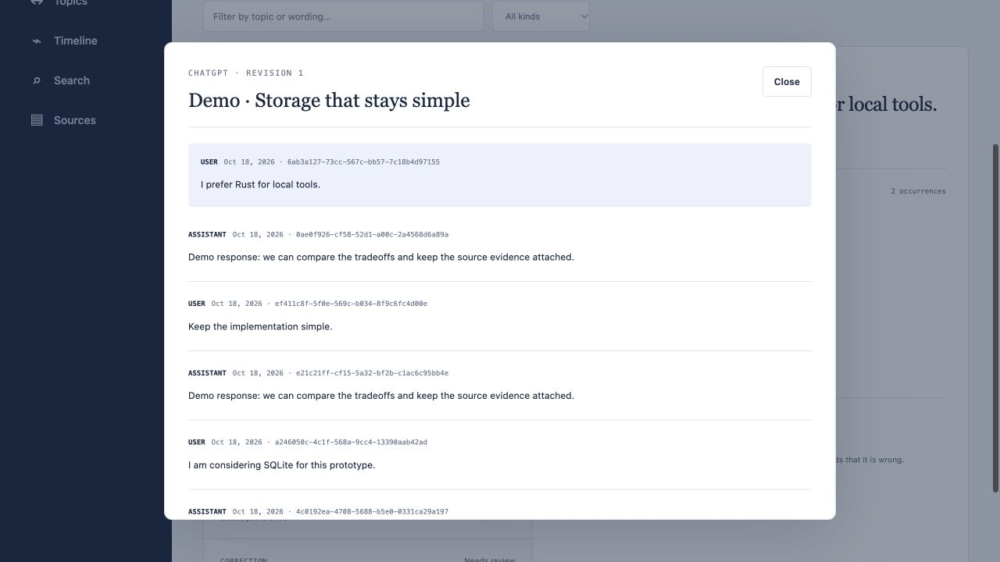
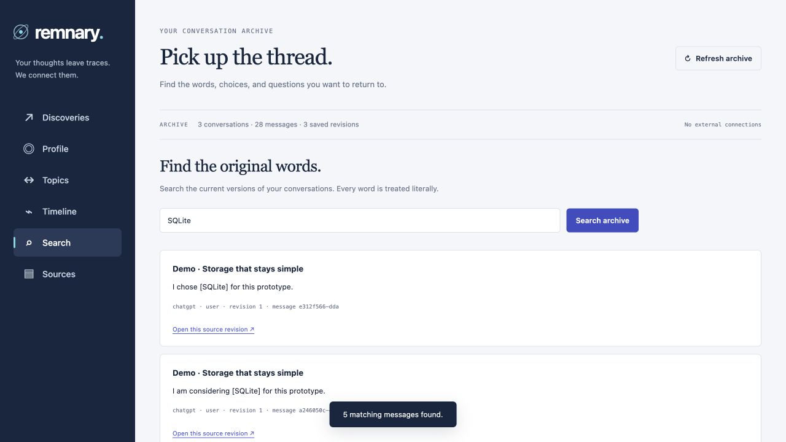
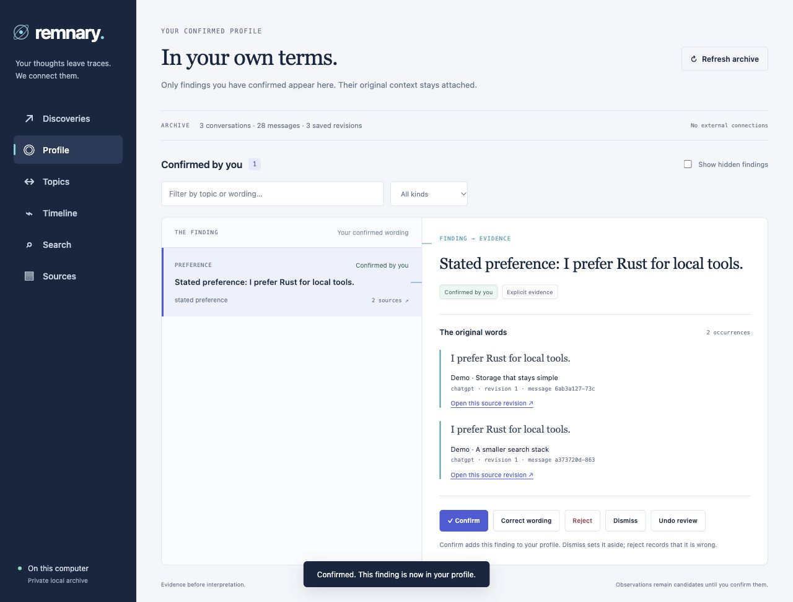
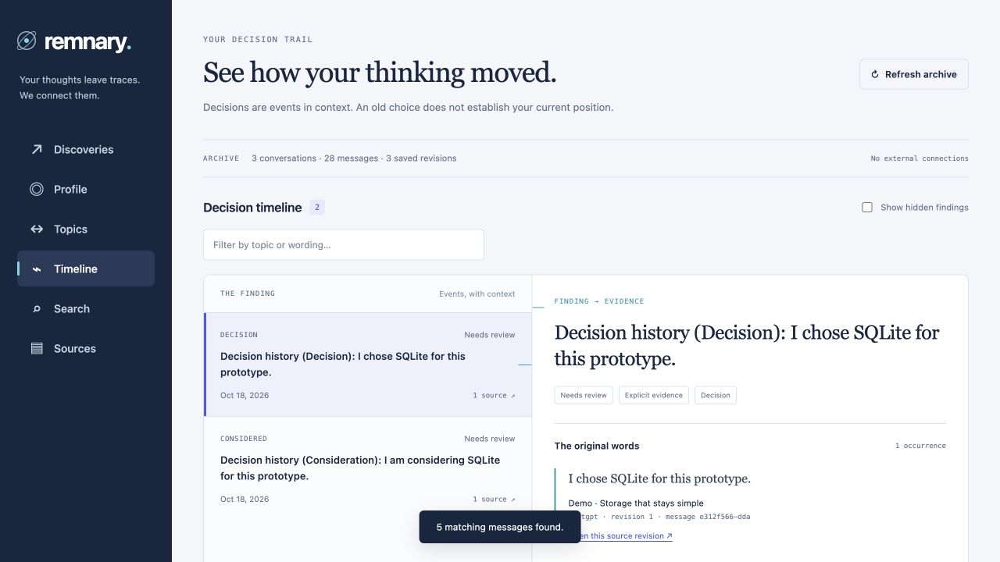
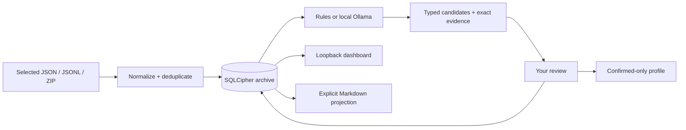

<p align="center">
  
</p>

<p align="center">
  <a href="https://github.com/diocata/remnary/actions/workflows/ci.yml"></a>
  <a href="LICENSE"></a>
  <a href="docs/platforms.md"></a>
  <a href="docs/readiness.md"></a>
</p>

# Remnary

**A living record of your thoughts, memories, and experiences.**

Your conversations contain ideas you return to, decisions you reconsider, and preferences you explain more than once. Remnary brings selected histories into one local archive, finds candidate connections, and keeps the original words attached. You decide which findings belong in your record.

One Rust binary. An encrypted SQLite archive. A localhost dashboard. A readable Markdown vault. Optional local model analysis; no account or model is needed for the built-in rules engine.

[See it](#see-it-in-action) · [Install](#install) · [Try the demo](#try-the-fictional-demo) · [Import](#bring-your-own-history) · [Commands](#command-reference) · [How it works](#how-it-works) · [Privacy](#privacy-and-data-ownership) · [Docs](#documentation) · [License](#license)

> **Cross-platform release:** download the archive for **Windows, Linux or macOS**, on **x86-64 or ARM64**, from [GitHub Releases](https://github.com/diocata/remnary/releases/latest). Every published release is gated on the native platform tests and executable smoke workflow. [Supported versions and signing limits →](docs/platforms.md)

## Why Remnary?

| The fragment | The useful record |
| --- | --- |
| “I already explained how I like this done.” | Candidate preferences and corrections, linked to the messages that support them. |
| “Did I choose this, or just consider it?” | Decision events that distinguish consideration, choice, reconsideration and reversal. |
| “This keeps coming up.” | Recurring evidence across independent conversations, with counts and exact citations. |
| “Where did that idea start?” | Local full-text search and immutable source revisions. |
| “I want to read it in my own notes.” | An Obsidian-compatible vault with source links and space for your annotations. |
| “That finding is wrong.” | Confirm, correct, reject, dismiss or undo a review. Automatic findings never confirm themselves. |

## See it in action

### From a candidate to the original words, then your profile

<p align="center">
  
</p>

**This is the real dashboard using fictional history**, captured as a guided sequence of steps. The demo has three conversations, 28 messages and nine grouped findings. Confirmation happens only in this synthetic archive. [Recreate it below](#try-the-fictional-demo), or open the [static screenshots](docs/assets/README.md) if you prefer no animation.

### The same workflow from your terminal


The CLI animation shows excerpts of actual command output; long IDs are abbreviated in the displayed commands. [Text transcript](docs/assets/cli-transcript.txt) · [Media provenance and regeneration](docs/assets/README.md).

<details>
<summary><strong>Screenshot gallery — source evidence, confirmed profile, search and decisions</strong></summary>

| Exact source revision | Literal conversation search |
| --- | --- |
|  |  |

| Reviewed knowledge | A choice with its earlier consideration |
| --- | --- |
|  |  |

[Full discoveries view](docs/assets/discoveries.png). All images use the same bundled fictional history. No private account exports, real quotations, keys or bearer URLs are included.

</details>

## Install

### Download a binary — no Rust required

Open [the latest release](https://github.com/diocata/remnary/releases/latest) and choose your system:

| System | CPU | Archive suffix |
| --- | --- | --- |
| Windows | Intel/AMD x64 | `x86_64-pc-windows-msvc.zip` |
| Windows | ARM64 | `aarch64-pc-windows-msvc.zip` |
| Linux | Intel/AMD x64 | `x86_64-unknown-linux-gnu.tar.gz` |
| Linux | ARM64 | `aarch64-unknown-linux-gnu.tar.gz` |
| macOS | Intel | `x86_64-apple-darwin.tar.gz` |
| macOS | Apple Silicon | `aarch64-apple-darwin.tar.gz` |

Extract the archive into a folder you own. In that folder, run `./remnary --help` on Linux/macOS or `.\remnary.exe --help` in PowerShell. Add that folder to your `PATH` for convenience, or keep using the explicit executable path. The dashboard opens in your browser; there is no separate desktop installer.

Each archive includes the guides, demo, both licenses, target-specific notices and `BUILD.json`. Verify its SHA-256 against the accompanying `.sha256` or `SHA256SUMS` file. Linux binaries require **glibc 2.35+**; musl/Alpine is outside this matrix. macOS builds target **13.0+** and are runtime-tested on macOS 15. Windows binaries bundle the MSVC runtime. These are unsigned on Windows and ad-hoc signed/unnotarized on macOS; source builds remain available for environments that require other distribution policies.

### Build from source

You need Git, the pinned **Rust 1.99.1** toolchain and native C build tools. macOS uses CommonCrypto. Linux and Windows build bundled OpenSSL and additionally need Perl and make/MSVC build tools; see the [platform build instructions](docs/platforms.md). Downloaded binaries do not need those build tools.

```sh
git clone https://github.com/diocata/remnary.git
cd remnary
cargo install --path . --locked
remnary --version
```

`rust-toolchain.toml` pins the tested toolchain. Make sure Cargo’s binary directory is on your `PATH`. To build without installing:

```sh
cargo build --release --locked
./target/release/remnary --help
```

`./scripts/cargo-local` is a convenience for the original development workspace’s isolated toolchain; it falls back to installed Cargo. It is not required for a normal clone.

### Make your own checked local package

From a clean committed checkout:

```sh
python3 scripts/package-release.py --release
```

This runs formatting, locked tests, Clippy, optimized compilation, signature verification and an encrypted CLI smoke test. The archive and SHA-256 checksum are written under `target/dist/`. It includes the binary, documentation, visual assets, demo, both project license texts and third-party notices. macOS packages are ad-hoc signed/unnotarized, and Windows packages are unsigned. This command does not publish them; version tags publish through the gated GitHub workflow. [Packaging details →](docs/releasing.md)

## Try the fictional demo

The fastest way to explore without importing your history:

```sh
# From the cloned repository, after installing the CLI:
python3 scripts/demo.py

# Or use a local build:
python3 scripts/demo.py --binary ./target/release/remnary
```

The script uses only [`examples/demo/conversations.json`](examples/demo/conversations.json). It creates a new private `.remnary/demo/` directory, a recovery key, an encrypted archive and a Markdown vault; runs import, rules analysis and integrity checks; and prints the exact command to start its dashboard. Run **one** of the alternatives above. Existing demo directories are never overwritten; choose another with `--directory .remnary/demo-2`.

In the dashboard, open a source citation, confirm the fictional Rust preference, then open **Profile**. Try **Search → SQLite** and **Timeline**. The initial profile is empty until you review something. No account discovery or model call takes place. [Walkthrough and expected results →](examples/demo/README.md)

## Quick start

On macOS and Windows, these commands use the native credential store by default:

```sh
remnary init
remnary import /path/to/conversations.json
remnary analyze
remnary discover
remnary web
```

`init` creates a random encryption key in macOS Keychain or Windows Credential Manager. The default archive is under `~/Library/Application Support/remnary` on macOS and your Windows local application-data directory on Windows. Initialization does not scan sources or call a model. `web` prints a loopback URL containing a private session token. Open the complete link; stop the server with Ctrl-C.

**On Linux, create a private key once and select it on each command:**

```sh
mkdir -p "$HOME/.config/remnary"
chmod 700 "$HOME/.config/remnary"
remnary key create "$HOME/.config/remnary/recovery.key"
remnary --key-file "$HOME/.config/remnary/recovery.key" init
remnary --key-file "$HOME/.config/remnary/recovery.key" import /path/to/conversations.json
remnary --key-file "$HOME/.config/remnary/recovery.key" analyze
remnary --key-file "$HOME/.config/remnary/recovery.key" web
```

To choose a separate archive and private key on any platform:

```sh
# Use an existing private parent directory; choose a new key filename.
remnary key create /private/keys/remnary.key
remnary --data-dir /private/archive --key-file /private/keys/remnary.key init
remnary --data-dir /private/archive --key-file /private/keys/remnary.key import /path/to/conversations.json
```

On Linux, choose a private location such as `$HOME/.local/share/remnary` and create the parent directory first. The `/private/...` paths above are placeholders, not required OS directories. On PowerShell, use Windows paths and `remnary.exe`. Use the same `--data-dir` and `--key-file` with subsequent commands. Key files must be private regular files, with Unix mode `0600`. Keychain access may prompt. [Existing development archives →](docs/renaming.md)

## Bring your own history

| Source | Selected input | Status |
| --- | --- | --- |
| **ChatGPT** | Mapping-format `conversations.json`; ZIP with that file or numbered conversation shards | Supported format with synthetic ZIP tests and five published real mapping records. An original account-export ZIP remains unverified. |
| **Claude Code** | Local session JSONL file or directory | Supported; exercised on local histories. This is different from Claude consumer exports. |
| **Codex** | Local rollout JSONL file or directory | Supported; attribution and inherited-session handling have regression coverage. |
| **Kiro IDE** | Local `.chat` JSON file or selected chat directory | Supported observed format; cumulative copied dialogue is correlated conservatively. |
| **Partial app history views** | Explicitly supplied ChatGPT snapshot JSON | Advanced/manual adapter; missing context and truncation stay labelled. No built-in account connector. |

```sh
# Inventory known local session locations; this does not import message bodies.
remnary sources --detect

# Choose the files or directory you want imported.
remnary import /path/to/chatgpt-export.zip
remnary import ~/.claude/projects --source claude-code
remnary import ~/.codex/sessions --source codex
remnary import "$HOME/Library/Application Support/Kiro/User/globalStorage/kiro.kiroagent" --source kiro

remnary status
remnary sources
```

Imports preserve normalized revisions. Reimporting unchanged input does not add duplicate records. Detection is separate from import; there is no automatic watcher, browser extension or provider login flow. Private application formats can change. Claude consumer exports, Kiro CLI exports, Cursor databases and Gemini account histories are not supported adapters today. [Exact format boundaries, limits and attribution →](docs/sources.md)

## Review what Remnary finds

```sh
remnary discover --all --limit 100
remnary patterns
remnary patterns --topics
remnary profile --candidates
remnary timeline
remnary today --date 2026-10-18 --timezone Europe/Luxembourg
```

Findings carry a type, a source-linked statement, an explicit/inferred label, supporting messages and a review status. Recurring support means the evidence repeats; it does not make a personal fact confirmed.

```sh
# Replace OBSERVATION_ID with an ID from `discover`.
remnary feedback OBSERVATION_ID confirm
remnary feedback OBSERVATION_ID correct --text "My preferred wording and context"
remnary feedback OBSERVATION_ID reject
remnary feedback OBSERVATION_ID dismiss
remnary feedback OBSERVATION_ID reset

remnary profile
```

**Confirm** includes the finding in your profile. **Correct** saves your wording as confirmed. **Reject** records that it is wrong; **dismiss** sets it aside. **Reset** undoes the current review while retaining its history. Source evidence stays attached. The dashboard offers the same main review actions.

The typed extraction format supports explicit and inferred preferences, corrections, decisions, topics, project references and behavioral patterns. The default rules engine recognizes a deliberately small set of English statements and comparison requests. Richer extraction uses the optional model; no engine gives perfect interpretation. [Evaluation and known errors →](docs/readiness.md)

## Search and follow the evidence

```sh
remnary search "SQLite"
remnary sources
remnary show CONVERSATION_ID --revision 1
```

Search uses SQLite full-text indexing over current, available conversations. Query words are treated literally and must match within a message. Source links in findings open their exact retained revision, even after a newer revision is imported. Missing timestamps stay unknown; partial views remain partial. There is no semantic/vector search service in this release.

## Build a readable knowledge vault

```sh
remnary vault sync /path/to/Remnary-vault --timezone Europe/Luxembourg
remnary export /path/to/transcript-snapshots
```

`vault sync` creates linked knowledge notes; `export` creates immutable transcript snapshots. Obsidian is optional—these are regular Markdown files.

```text
Remnary-vault/
├── Home.md                 Your starting point
├── Profile.md              Only confirmed knowledge
├── Discoveries.md          Ranked, reviewable findings
├── Topics.md               Related-topic threads
├── Candidates/             Individual unconfirmed findings
├── Decisions/              Decision-event notes
├── Patterns/               Evidence-linked pattern notes
├── Topics/                 Individual related-topic notes
├── Daily/                  Activity digests by local date
└── Transcripts/            Source-revision snapshots
```

Generated sections have ownership hashes. Write your own annotations **outside** those sections; synchronization preserves them. Edited generated sections produce conflicts rather than silent overwrites. You can also author an explicit `remnary-feedback` block and validate it before applying it. [Markdown feedback example →](docs/vault-feedback.md)

**Vaults and transcript exports are plaintext.** Generate them in a location you choose to protect. Sync again after review changes; `cleanup` retries managed projection cleanup. Original exports, independent copies and older backups remain outside the canonical deletion boundary.

## Optional local model

Rules analysis works without a model. For richer candidate extraction, install Ollama and a local model separately, then start a trusted loopback daemon with cloud features disabled:

```sh
OLLAMA_NO_CLOUD=1 ollama serve
remnary analyze --engine ollama --model YOUR_INSTALLED_LOCAL_MODEL
```

The evaluated setup uses `gemma4:12b-it-q4_K_M` on an M4 Pro with 24 GiB memory. Model downloads and inference require additional disk space, memory and time. Remnary does not download models automatically. [Exact setup, model identity and evaluation →](docs/local-model.md)

Remnary rejects advertised cloud models and non-loopback endpoints, applies best-effort redaction, constrains citations, separately checks claim support and validates exact eligible-owner evidence. It still depends on a trustworthy local daemon. Model errors can remain; your review determines confirmed knowledge.

## How it works




The archive stores conversations, immutable revisions, full-text indexes, observations, feedback and deletion tombstones in **one SQLCipher-encrypted SQLite file**. Direct `rusqlite` calls keep the core small. No ORM, database server, vector service or cloud account is required.

Why SQLite rather than DuckDB or a folder of JSON? The core workload needs transactional imports, revisions, relationships, review changes and deletion. JSON/JSONL is useful interchange; Markdown is useful reading and annotation. DuckDB could serve a future analytics export, but maintaining a second database adds work to the present workflow. [Architecture and invariants →](docs/architecture.md)

## Privacy and data ownership

| Boundary | Current behavior |
| --- | --- |
| Collection | Files you explicitly select. Detection inventories known locations separately. |
| Canonical storage | SQLCipher encrypts conversations, metadata, derived records and full-text indexes. |
| Keys | macOS Keychain, Windows Credential Manager, or an explicit private recovery-key file (required on Linux). No automatic replacement of a missing original key. |
| Dashboard | Authenticated loopback server with bearer, Host/Origin, content and CSP checks. No external assets in the app. |
| Analysis | Built-in rules, or an explicitly selected trusted local Ollama daemon. No cloud extraction or telemetry. |
| Personal profile | Only explicit confirmation or correction promotes a finding. |
| Markdown | Explicitly generated plaintext; owned sections tracked for cleanup. |
| Deletion | Canonical data and tracked projections; cannot erase original exports, independent copies or historical backups. |

```sh
remnary exclude CONVERSATION_ID
remnary include CONVERSATION_ID
remnary privacy list
remnary cleanup
```

Persistent provider, project, directory and literal-topic exclusions can cover retained sources and future imports. Permanent deletion commands are available separately; review their help and backup boundaries before use. [Privacy controls →](docs/privacy.md) · [Security and reporting →](SECURITY.md)

## Back up and recover

```sh
remnary doctor
remnary key export /private/keys/recovery.key
remnary backup /private/backups/archive.sqlite3
remnary --data-dir /path/to/new-archive --key-file /private/keys/recovery.key restore /private/backups/archive.sqlite3
remnary --data-dir /path/to/new-archive --key-file /private/keys/recovery.key doctor
```

Keep recovery keys separate from backups. Restore uses the key that encrypted that backup and requires an unused destination. Losing both Keychain access and the recovery key loses access to the encrypted data. Key rotation uses a verified new-key copy/new-archive workflow. [Recovery, plaintext upgrades and key rotation →](docs/recovery.md)

## Command reference

Run `remnary COMMAND --help` for arguments and flags. `--data-dir` and `--key-file` are global options.

| Command | Purpose |
| --- | --- |
| `init`, `status`, `doctor` | Initialize, inspect counts, check integrity and pending cleanup. |
| `import`, `import-app-snapshot` | Import selected files or an explicitly supplied partial view. |
| `sources --detect`, `sources` | Inventory known local locations; list imported source identities. |
| `analyze` | Incremental rules or local-model extraction. |
| `discover`, `patterns`, `patterns --topics` | Review ranked findings, recurring evidence and related topics. |
| `profile`, `profile --candidates` | Confirmed knowledge or candidate review. |
| `timeline`, `today` | Decision events and local-day activity digests. |
| `search`, `show` | Literal full-text search and exact normalized revisions. |
| `feedback` | Confirm, correct, reject, dismiss, supersede or reset a review. |
| `web` | Start the authenticated localhost dashboard. |
| `vault sync`, `vault apply-feedback`, `export` | Managed knowledge notes, explicit Markdown review and transcript snapshots. |
| `exclude`, `include`, `privacy` | Manual and persistent source exclusions. |
| `delete`, `cleanup` | Canonical deletion and managed projection cleanup. |
| `key`, `backup`, `restore`, `encrypt-copy` | Recovery keys, encrypted snapshots and explicit legacy conversion. |

`--insecure-plaintext` is an explicit development/legacy mode. It never decrypts an encrypted archive. Prefer the default encrypted workflow.

## Validation and performance

**224 offline tests pass locally**, including encrypted CLI workflows and rename compatibility. The local release recipe also checks formatting, Clippy with warnings denied, optimized builds, ad-hoc signatures and encrypted smoke behavior. Separate model suites and process-interruption recovery checks are recorded in [release evidence](docs/readiness.md).

A prior optimized build on an M4 Pro / 24 GiB imported a synthetic **2,000-conversation / 32,000-message** dataset in **3.04 seconds**, searched in **75.6–76.4 ms including startup/unlock**, and completed cached rules analysis in **0.17 seconds**. The browser also rendered 2,000 source rows and a 2,000-citation finding. These are local engineering observations, not performance guarantees. [Benchmark scope, memory and reproduction →](docs/performance.md)

The 86-conversation real-history development assessment rated 33/34 observations grounded and four of the top five useful. It was agent-assessed under the owner’s delegation, **not an independent human study**. One uncertainty-loss error remains documented. No owner confirmation was fabricated; findings stay candidates until reviewed. [Assessment limitations →](docs/readiness.md)

## Roadmap and current limits

| Available | Later work |
| --- | --- |
| Manual selected-source imports | Universal live collection and browser extension |
| CLI + localhost dashboard | Complete TUI and production daemon |
| Rules + optional local Ollama | Broader extraction and independently assessed quality |
| Full-text search + related topics | Semantic/vector search |
| Local encrypted archive + explicit Markdown | Mobile clients and cloud sync |
| Conservative review workflow | Autonomous rule enforcement |
| Native CI packages for Windows, Linux and macOS; x64/ARM64 | Signed/notarized installers and additional OS/CPU targets |

The [product brief](docs/product-brief.md) describes the broader vision; its first-release boundary is §24. A roadmap item is not a supported feature.

## Frequently asked questions

<details>
<summary><strong>Does Remnary need an LLM, subscription or provider account?</strong></summary>

No for the rules workflow. The demo runs entirely from bundled fictional files. An optional local model needs its own separately installed runtime and model. To import your account history, you provide an export or supported local session files.

</details>

<details>
<summary><strong>Can it read all my ChatGPT or Claude conversations automatically?</strong></summary>

No. The CLI does not log into provider accounts or scrape your browser. ChatGPT mapping exports and selected local Claude Code/Codex/Kiro files are supported. Partial app snapshots are an explicit advanced input, not a built-in account connector. Claude consumer exports are a separate unsupported format.

</details>

<details>
<summary><strong>Does recurring evidence mean a preference is confirmed?</strong></summary>

No. It means the available evidence repeats across counted conversations. Only your confirmation or correction adds a finding to the confirmed profile. Related topics preserve separate claims and contexts instead of silently merging them into an enduring personal trait.

</details>

<details>
<summary><strong>Do I need Obsidian? Can I edit generated notes?</strong></summary>

Obsidian is optional. Any Markdown reader works. Edit your annotations outside generated sections; managed-body edits become conflicts. Explicit review blocks can change findings through the validated feedback workflow.

</details>

<details>
<summary><strong>Why is the profile empty after analysis?</strong></summary>

That is expected. Analysis creates candidates. Review one with `feedback ID confirm`, correct its wording, or use the dashboard. The fictional demo also starts with an empty profile.

</details>

<details>
<summary><strong>Where does the name come from?</strong></summary>

**Remnant + diary.** A remnant is a trace of something from the past; a diary is a personal record of experiences, thoughts and activities. Remnary is an invented word, not an established dictionary entry. It represents a living record built from fragmented conversations, with room to grow beyond AI tools.

</details>

## Documentation

| Guide | What you will find |
| --- | --- |
| [Demo walkthrough](examples/demo/README.md) | Recreate the screenshots with fictional history. |
| [Source adapters](docs/sources.md) | Formats, attribution, partial views and input bounds. |
| [Architecture](docs/architecture.md) | Storage, identity, extraction and evidence invariants. |
| [Local model](docs/local-model.md) | Runtime setup, model identity and regression evidence. |
| [Vault feedback](docs/vault-feedback.md) | Review blocks, validation and stale-review protection. |
| [Privacy](docs/privacy.md) | Exclusion scopes, deletion and projection boundaries. |
| [Recovery](docs/recovery.md) | Backups, restore, key changes and plaintext conversion. |
| [Platforms](docs/platforms.md) | Tested target and portability limits. |
| [Readiness](docs/readiness.md) | Acceptance evidence, measured quality and known errors. |
| [Performance](docs/performance.md) | Reproducible synthetic benchmark and limitations. |
| [Releasing](docs/releasing.md) | Local packaging, hashes, notices and signing scope. |
| [Rename compatibility](docs/renaming.md) | Existing archives and older development formats. |
| [Changelog](docs/changelog.md) | Release history. |
| [Media sources](docs/assets/README.md) | Artwork, screenshots, GIFs and regeneration. |

## Contributing

Focused fixes, adapter fixtures, reproducible bug reports and documentation improvements are welcome. Start with [CONTRIBUTING.md](CONTRIBUTING.md).

```sh
cargo fmt --check
cargo test --locked --all-targets
cargo clippy --locked --all-targets -- -D warnings
cargo build --release --locked
```

Use synthetic fixtures only. Keep real exports, histories, keys, generated personal vaults and model traces outside Git. Report sensitive issues privately to the repository owner; public issues should use nonsensitive reproductions. [Security reporting →](SECURITY.md)

## License

Remnary’s original code, documentation and artwork are dual-licensed under **MIT OR Apache-2.0**, at your option:

- [MIT License](LICENSE-MIT)
- [Apache License, Version 2.0](LICENSE-APACHE)

Copyright © 2026 Diogo Catarino and Remnary contributors. See the [license overview](LICENSE) and [NOTICE](NOTICE).

Dependencies and separately licensed fixtures retain their own terms. The repository includes [native notices](third_party/notices/), [153 target-specific dependency notice sets](third_party/README.md), a [dependency inventory](third_party/dependencies.json) and the unmodified MPL dependency source required by that inventory. The published upstream ChatGPT compatibility fixture has [its own license](tests/fixtures/upstream-chatgpt-LICENSE.txt). These materials are not relicensed by the Remnary license choice.
