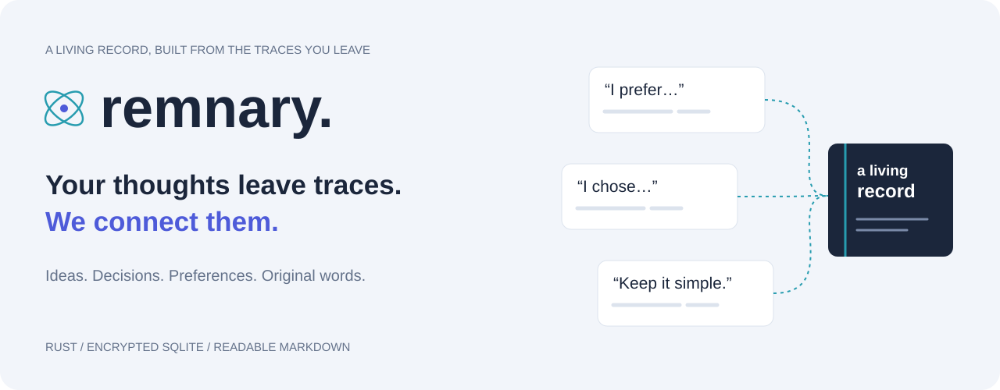
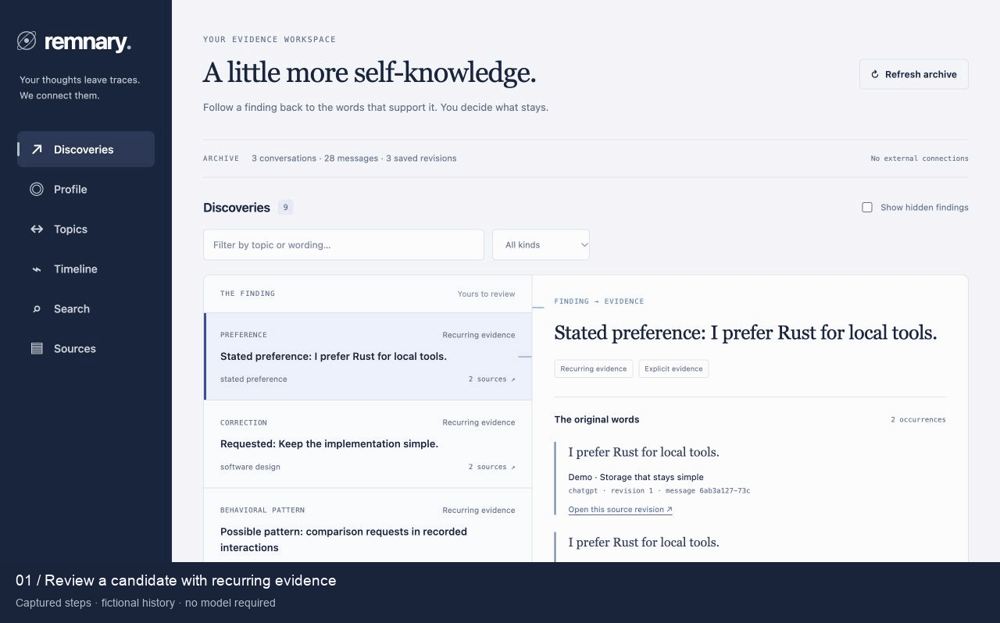
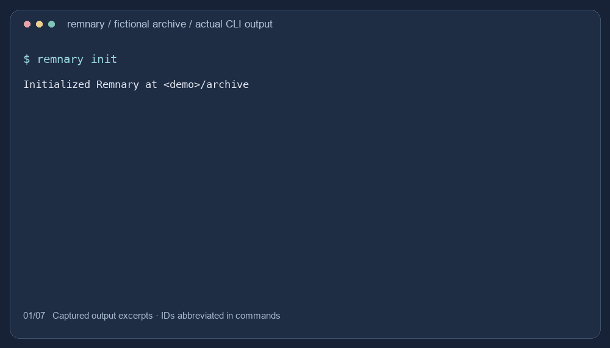
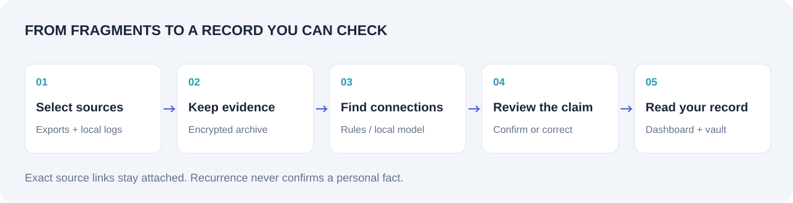

<p align="center">
  
</p>

<p align="center">
  <a href="https://github.com/diocata/remnary/actions/workflows/ci.yml"></a>
  <a href="LICENSE"></a>
  <a href="docs/platforms.md"></a>
  <a href="docs/readiness.md"></a>
</p>

# Remnary

**Your thoughts leave traces. We connect them.**

Search your AI conversations and review the ideas, decisions and preferences found in them. Each finding links to its source messages. You choose what goes into your profile.

Remnary runs locally as a Rust CLI with an encrypted SQLite archive, a browser dashboard and Markdown export. Ollama is recommended for analysis; basic rules work without a model.

[Install](#install) · [Configuration](#configuration-and-analysis) · [Quick start](#quick-start) · [Demo](#try-the-fictional-demo) · [Usage](docs/usage.md) · [Privacy](#privacy-and-data-ownership) · [Documentation](docs/README.md)

## What it does

- Search imported histories and open the source messages.
- Review preferences, corrections, topics and decisions with supporting quotations.
- Confirm, correct, reject or dismiss findings.
- Export an Obsidian-compatible Markdown vault and add your own notes.

The name combines **remnant + diary**.

## See it in action



The dashboard with bundled **fictional history**: three conversations, 28 messages and nine grouped findings. [Try it yourself](#try-the-fictional-demo) · [Static screenshots](docs/assets/README.md)

<details>
<summary>Watch the CLI walkthrough</summary>



Recorded command output; displayed IDs are abbreviated. [Text transcript](docs/assets/cli-transcript.txt) · [Media sources and regeneration](docs/assets/README.md)

</details>

## Install

Download an archive from [GitHub Releases](https://github.com/diocata/remnary/releases/latest). No Rust or database installation is required.

| System | CPU | Choose the archive ending in |
| --- | --- | --- |
| Windows | Intel/AMD x64 | `x86_64-pc-windows-msvc.zip` |
| Windows | ARM64 | `aarch64-pc-windows-msvc.zip` |
| Linux | Intel/AMD x64 | `x86_64-unknown-linux-gnu.tar.gz` |
| Linux | ARM64 | `aarch64-unknown-linux-gnu.tar.gz` |
| macOS | Intel | `x86_64-apple-darwin.tar.gz` |
| macOS | Apple Silicon | `aarch64-apple-darwin.tar.gz` |

Extract it into a folder you own. Run `./remnary --help` on macOS/Linux or `.\remnary.exe --help` in PowerShell. Add that folder to your `PATH` to use the commands below as written. There is no separate desktop installer; the dashboard runs in your browser.

Verify the download against its `.sha256` file or `SHA256SUMS`. Linux requires **glibc 2.35+**; macOS builds target **13.0+**. Windows binaries are unsigned; macOS binaries are ad-hoc signed and unnotarized. [Tested versions, build prerequisites and signing limits](docs/platforms.md).

To build from source, install Git, Rust **1.99.1** and the [native build tools](docs/platforms.md#source-builds), then run:

```sh
git clone https://github.com/diocata/remnary.git
cd remnary
cargo install --path . --locked
```

## Configuration and analysis

**Ollama is recommended for analyzing normal conversation wording.** Rules are available when you do not want to run a model, but they only match the English patterns listed below.

| Mode | Setup | Command |
| --- | --- | --- |
| Ollama (recommended) | Install Ollama, download a local model and start its daemon | `remnary analyze --engine ollama --model MODEL_NAME --endpoint http://127.0.0.1:11435 --progress` |
| Rules (CLI default) | Nothing beyond Remnary | `remnary analyze` |

Remnary does not install, download, select or start a model. There is no setup wizard or persistent configuration file. Pass the engine, model and endpoint on each run. Both modes produce findings for you to review; neither confirms a personal fact automatically.

### Run with Ollama

First initialize your archive and import messages using [Quick start](#quick-start).

**1. Install Ollama.** On macOS with Homebrew:

```sh
brew install ollama
```

For Windows or Linux, use the [official Ollama download](https://ollama.com/download).

**2. Start a local daemon in one terminal** (macOS/Linux):

```sh
OLLAMA_NO_CLOUD=1 OLLAMA_HOST=127.0.0.1:11435 ollama serve
```

Keep that terminal open. This disables cloud features and listens on localhost port 11435. From a clone, `./scripts/ollama-local` starts the daemon with the same address and additional resource/logging limits.

**3. In another terminal, download the model and analyze your messages:**

```sh
export OLLAMA_HOST=127.0.0.1:11435
ollama pull gemma4:12b-it-q4_K_M
remnary analyze --engine ollama --model gemma4:12b-it-q4_K_M \
  --endpoint http://127.0.0.1:11435 --progress
remnary discover
remnary web
```

[This model](https://ollama.com/library/gemma4:12b-it-q4_K_M) is an approximately 8 GB download and was evaluated on an M4 Pro with 24 GiB memory. Downloads contact the model registry; analysis uses the local daemon. You can substitute another installed local model, but results and memory requirements will differ. `ollama list` shows installed model names.

On Linux, also pass your `--key-file` to each Remnary archive command. Keep `--endpoint` on model runs: the CLI defaults to port 11434, while these instructions use 11435. Stop the daemon with Ctrl-C. [Model setup and measured results](docs/local-model.md).

<details>
<summary>Windows PowerShell commands</summary>

After installing Ollama and importing your messages, start the daemon in one terminal:

```powershell
$env:OLLAMA_NO_CLOUD = "1"
$env:OLLAMA_HOST = "127.0.0.1:11435"
ollama serve
```

In another terminal:

```powershell
$env:OLLAMA_HOST = "127.0.0.1:11435"
ollama pull gemma4:12b-it-q4_K_M
remnary analyze --engine ollama --model gemma4:12b-it-q4_K_M --endpoint http://127.0.0.1:11435 --progress
remnary web
```

</details>

### What the rules recognize

Rules match sentence beginnings, ignoring case. These are the current patterns:

| Finding | Recognized beginnings |
| --- | --- |
| Preference | `i prefer` |
| Dislike | `i don't like`, `i do not like` |
| Consideration | `i am considering`, `i'm considering`, `i considered` |
| Proposal | `i propose`, `i suggest` |
| Choice | `i chose`, `i have decided`, `i've decided`, `i decided` |
| Reconsideration | `i am reconsidering`, `i'm reconsidering`, `i reconsidered` |
| Confirmation | `i reaffirm`, `i confirm` |
| Reversal | `i reversed my decision`, `i changed my mind` |
| Instruction/correction | `keep`, `don't`, `do not`, `stop`, `avoid`, `reuse`, `give me shorter` |

The phrase must include text after the prefix. A leading `again,` is allowed. Questions are not treated as explicit statements. A few exact whole-instruction variants are grouped under the same meaning: keep code simple, avoid new dependencies, avoid unnecessary Markdown files, reuse components, preserve working code and keep explanations concise.

A separate rule detects repeated comparison requests:

- `compare`, `can you compare`, `could you compare` or `would you compare`, with a comparison separator such as `and`, `versus`, `vs`, `with` or `to`.
- Questions starting with `which` and containing `best`, `better` or `more`.
- Questions shaped like `Rust or Go for web APIs?`.

A leading `please` is allowed. Negated comparisons are skipped. The pattern requires two different requests in two distinct messages in the same conversation. It records those requests, not a general preference for comparisons.

**Wording matters:** `Remove comment lines` is missed; `Don't add comments` matches an instruction. Rules mainly cover English and are not user-configurable. Recognized code blocks, quoted material, pasted transcripts and non-owner messages are filtered before extraction. Each finding keeps its source quotation. See the [rule implementation](src/analysis/intelligence/rules.rs) for the exact checks and limits.

## Quick start

**macOS and Windows** use Keychain or Credential Manager by default:

```sh
remnary init
remnary import /path/to/conversations.json
remnary analyze
remnary discover
remnary web
```

Replace the import path with your export. In PowerShell, use a Windows path such as `C:\path\to\conversations.json`.

**Linux requires a private key file.** Create it once, then pass it to every archive command:

```sh
mkdir -p "$HOME/.config/remnary"
chmod 700 "$HOME/.config/remnary"
remnary key create "$HOME/.config/remnary/recovery.key"
remnary --key-file "$HOME/.config/remnary/recovery.key" init
remnary --key-file "$HOME/.config/remnary/recovery.key" import /path/to/conversations.json
remnary --key-file "$HOME/.config/remnary/recovery.key" analyze
remnary --key-file "$HOME/.config/remnary/recovery.key" discover
remnary --key-file "$HOME/.config/remnary/recovery.key" web
```

`init` creates your archive without scanning sources. `web` prints a private localhost link; open the complete URL and stop the server with Ctrl-C. Keep its session token private.

The profile starts empty. Confirm or correct a finding in the dashboard to add it. Keep a recovery key separate from your backups; losing access to the key means losing access to the archive. [Recovery guide](docs/recovery.md) · [Choose a separate archive](docs/usage.md#choose-a-separate-archive)

## Try the fictional demo

From the cloned repository or extracted release folder, with Python 3.11+ and `remnary` on your `PATH`:

```sh
python3 scripts/demo.py
```

Use `python` on Windows if that is your Python command. The script creates a fresh encrypted demo archive and vault, then prints the command to start its dashboard. Existing demo directories are never overwritten. It imports only the bundled fictional files and makes no model calls.

[Walkthrough, local-binary options and expected results](examples/demo/README.md)

## Bring your own history

| Source | Selected input |
| --- | --- |
| ChatGPT | Mapping-format `conversations.json` or a supported ZIP export |
| Claude Code | Local session JSONL files or a directory |
| Codex | Local rollout JSONL files or a directory |
| Kiro IDE | Local `.chat` JSON files or a directory |

`remnary sources --detect` inventories known local locations. You choose what to import; Remnary does not log into accounts or collect history automatically. Reimporting unchanged files does not duplicate conversations.

Private provider formats can change. Claude consumer exports and Kiro CLI exports are separate, unsupported formats. An original ChatGPT account-export ZIP remains unverified; supported ZIP layouts have synthetic coverage. [Input formats, examples and limits](docs/sources.md) · [Import commands](docs/usage.md#bring-your-own-history)

## Use your record

```sh
remnary search "SQLite"
remnary patterns --topics
remnary timeline
remnary feedback OBSERVATION_ID confirm
remnary profile
remnary vault sync /path/to/Remnary-vault
```

Replace `OBSERVATION_ID` with an ID from `remnary discover`. On Linux, include your `--key-file` on these commands too.

The optional vault contains a Home page, profile, discoveries, decisions, patterns, daily digests and source transcripts. Obsidian is optional. Write annotations outside generated sections; edits to generated content are preserved as conflicts.

For model analysis, follow [Run with Ollama](#run-with-ollama). [Full usage and command reference](docs/usage.md#command-reference).

## How it works



SQLCipher stores conversations, revisions, search indexes, findings and feedback in one encrypted SQLite archive. Rules or optional local-model analysis produce candidates; only your review adds them to the confirmed profile. [Architecture and source map](docs/architecture.md)

## Privacy and data ownership

- **Local storage and analysis.** No cloud extraction or telemetry. Optional model analysis depends on a trusted local daemon.
- **Explicit collection.** Import files you select. Detection and import are separate steps.
- **Plaintext exports.** Markdown vaults and transcript exports are readable files; protect their location yourself.
- **Bounded deletion.** Cleanup covers canonical data and tracked projections. It cannot erase original exports, independent copies or older backups.

[Exclusions and deletion](docs/privacy.md) · [Backups and recovery](docs/recovery.md) · [Security reporting](SECURITY.md)

## Documentation

[All guides](docs/README.md) · [Usage and commands](docs/usage.md) · [Source formats](docs/sources.md) · [Local models](docs/local-model.md) · [Vault feedback](docs/vault-feedback.md) · [Release notes](docs/changelog.md)

**226 offline tests pass locally.** CI builds and tests Windows, Linux and macOS on x64 and ARM64. Quality assessments and benchmarks have limits; see [validation evidence](docs/readiness.md) and [performance measurements](docs/performance.md).

Current scope is selected imports, CLI, browser dashboard and explicit Markdown output. Automatic collection, semantic search, mobile clients and cloud sync remain [future work](docs/product-brief.md).

## Contributing

Start with [CONTRIBUTING.md](CONTRIBUTING.md) and the [source map](docs/architecture.md#source-map). Use synthetic fixtures; keep real histories, keys, personal vaults and model traces outside Git.

## License

Original code, documentation and artwork are dual-licensed under **[MIT](LICENSE-MIT) OR [Apache-2.0](LICENSE-APACHE)**, at your option. Copyright © 2026 Diogo Catarino and Remnary contributors. [License overview](LICENSE) · [NOTICE](NOTICE)

Dependencies and separately licensed fixtures retain their own terms. See [third-party notices and inventories](third_party/README.md) and the [upstream fixture license](tests/fixtures/upstream-chatgpt-LICENSE.txt).
